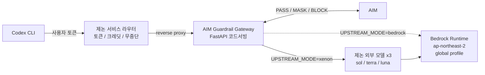
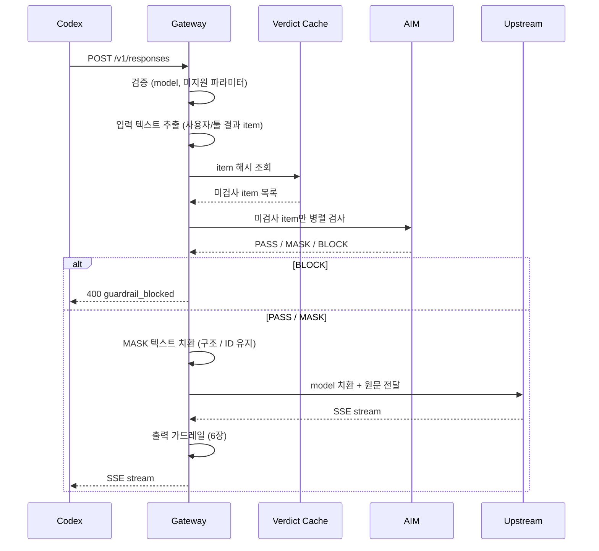

# AIM Guardrail Gateway 설계 문서

> 제논(Xenon) 코드서빙에 배포하는 LLM 게이트웨이. LLM 호출 앞뒤로 사내 가드레일 솔루션 **AIM**을 붙여 입력/출력을 검사한다.
> 1차 클라이언트는 **Codex CLI**, 업스트림 모델은 **Amazon Bedrock GPT-5.6 (Sol / Terra / Luna)**.
>
> 이 문서는 Claude Code에서 개발을 시작하기 위한 설계 + 구현 가이드다. 레포 루트 `AGENTS.md`가 이 문서의 16장 초안을 반영한다.

---

## 0. 목차

1. 목적과 범위
2. 결정 사항
3. 아키텍처
4. 엔드포인트
5. 요청 처리 파이프라인
6. 출력 가드레일 (스트리밍)
7. 모델 라우팅 / 업스트림
8. AIM 연동 (가정 스펙)
9. 에러 처리
10. 설정 (환경변수)
11. 프로젝트 구조
12. 배포
13. 개발 단계 (마일스톤)
14. 검증 체크리스트
15. 미결 / 확인 필요
16. AGENTS.md 초안
17. 구현 노트 (설계 대비 보완 사항)

---

## 1. 목적과 범위

**목적**
- 사내 사용자가 Codex 등 코딩 에이전트로 외부 LLM(Bedrock GPT-5.6)을 사용할 때, 모든 입력/출력이 AIM 가드레일을 거치도록 강제한다.

**범위 (In)**
- OpenAI 호환 게이트웨이: Responses, Chat Completions, (후순위) Anthropic Messages
- 입력 가드레일 (요청 → AIM → 업스트림)
- 출력 가드레일 (업스트림 → AIM → 클라이언트), 스트리밍 포함
- 모델명 → 업스트림(제논 외부 모델 리비전 / Bedrock 모델 ID) 매핑

**범위 (Out)**
- 사용자 인증/토큰 발급/크레딧 제한 → 앞단 **제논 서비스 라우터**가 담당
- 요청/응답 본문 로깅 → 하지 않음 (요구사항 아님)
- `previous_response_id` 기반 stateful 대화, WebSocket

---

## 2. 결정 사항

| # | 항목 | 결정 |
|---|---|---|
| D1 | 배포 방식 | 제논 **코드서빙**으로 FastAPI 서버 배포 (워크플로우 규격 미적용) |
| D2 | 앞단 | 제논 **서비스 라우터**로 코드서빙을 연동 (무중단 배포). 라우터는 리버스 프록시로 간주. 사용자 토큰 발급·크레딧 제한은 라우터에서 |
| D3 | 클라이언트 | Codex CLI. Codex는 `wire_api = "responses"`만 지원하므로 `/v1/responses`(SSE)가 필수 |
| D4 | 업스트림 | 1순위: 제논 **외부 모델**(OpenAI compatible 등록 → Chat Completions/Responses 둘 다 지원)로 3개 모델 등록 후 리비전 지정 호출. 2순위(fallback): Bedrock 직접 호출. `UPSTREAM_MODE`로 전환 |
| D5 | 모델 | GPT-5.6 Sol / Terra / Luna 3종 모두 노출 |
| D6 | Bedrock | `bedrock-runtime.ap-northeast-2.amazonaws.com`, 서울은 **global inference profile만 지원** → 모델 ID `global.openai.gpt-5.6-{sol,terra,luna}` |
| D7 | Bedrock 인증 | 1단계 Bedrock **장기 API 키**(Bearer) → 2단계 IAM 기반 전환 |
| D8 | AIM 판정 | `PASS` / `MASK` / `BLOCK` 3종 |
| D9 | AIM 규격 | 사내 가이드 미확보 → **가정 스펙으로 구현**, 어댑터 1개 파일에 격리. 인증 헤더는 `X-Starfort-Guard-Api-Key`로 추정 (환경변수로 변경 가능) |
| D10 | 비밀정보 | URL, 인증키 전부 환경변수 (k8s Secret 주입) |
| D11 | 로깅 | 본문 로깅 없음. 메타데이터/메트릭만 |
| D12 | egress | 제논 → AWS / AIM 통신 경로는 연동 시 방화벽 해제 진행 |

---

## 3. 아키텍처



**설계 원칙**
- **원문 패스스루**: 요청/응답 원문을 같은 포맷 그대로 업스트림/클라이언트에 전달한다. 가드레일 검사용 텍스트만 포맷별 extractor로 뽑는다. (Codex는 필드 하나만 깨져도 툴 루프가 깨짐)
- **수정은 최소한**: 게이트웨이가 바꾸는 건 `model` 필드, 업스트림 인증 헤더, MASK된 텍스트, 이벤트 `sequence_number` 뿐.
- **Stateless**: Codex는 매 턴 전체 input을 재전송하므로 서버 상태 불필요. (검사 결과 캐시만 존재)

---

## 4. 엔드포인트

| 구분 | Method / Path | 가드레일 | 업스트림 처리 | 단계 |
|---|---|---|---|---|
| 필수 | `POST /v1/responses` | 입력 + 출력 | Responses 그대로 전달 (stream / non-stream) | M1~M3 |
| 권장 | `POST /v1/chat/completions` | 입력 + 출력 | Chat Completions 그대로 전달 | M4 |
| 권장 | `GET /v1/models` | 없음 | 게이트웨이 `MODEL_MAP` 기반 목록 반환 | M0 |
| 권장 | `POST /v1/messages` | 입력 + 출력 | **Anthropic Messages → Responses 변환** 필요 | M6 (후순위) |
| 운영 | `GET /healthz` | 없음 | liveness, 프로세스 생존만 | M0 |
| 운영 | `GET /readyz` | 없음 | AIM / 업스트림 연결 확인 (짧은 타임아웃, 결과 캐시 10s) | M0 |
| 운영 | `GET /metrics` | 없음 | Prometheus | M5 |

**명시적 미지원 (400 반환)**
- `previous_response_id` 포함 요청 → `400 unsupported_parameter`
- `GET /v1/responses/{id}`, `DELETE /v1/responses/{id}` → `404`
- `background: true` → `400`
- WebSocket

**`GET /v1/models` 응답 예**
```json
{
  "object": "list",
  "data": [
    {"id": "gpt-5.6-sol",   "object": "model", "created": 0, "owned_by": "samsungcard-aim-gateway"},
    {"id": "gpt-5.6-terra", "object": "model", "created": 0, "owned_by": "samsungcard-aim-gateway"},
    {"id": "gpt-5.6-luna",  "object": "model", "created": 0, "owned_by": "samsungcard-aim-gateway"}
  ]
}
```

> `/v1/messages`는 업스트림이 GPT라 툴 호출, 스트리밍 이벤트, thinking 블록까지 매핑하는 변환 레이어가 필요하다. 공수가 크므로 Codex 경로 안정화 이후 진행.

---

## 5. 요청 처리 파이프라인



### 5.1 입력 검사 대상 추출

**Responses (`/v1/responses`)**

| 위치 | 검사 | 비고 |
|---|---|---|
| `instructions` | O | Codex 기본 지시문은 매 턴 동일 → 캐시로 1회만 검사됨 |
| `input`이 문자열 | O | |
| `input[]` `type=message`, `role in (user, developer, system)` → `content[].type=input_text`의 `text` | O | |
| `input[]` `type=function_call_output` → `output` | O | 파일 내용, 명령 결과 등. **보안상 핵심** |
| `input[]` `type=custom_tool_call_output` → `output` | O | Codex `apply_patch` 등 |
| `input[]` `role=assistant` 메시지, `function_call`, `custom_tool_call`, `reasoning` | X | 모델이 생성한 것 → 출력 단계에서 이미 검사됨 |
| `input_image`, `input_file` | X (1단계) | AIM이 텍스트 전용이라고 가정. 정책 확인 필요 |

**Chat Completions (`/v1/chat/completions`)**

| 위치 | 검사 |
|---|---|
| `messages[]` `role in (system, developer, user)` → `content`(문자열 또는 `type=text` 파트) | O |
| `messages[]` `role=tool` → `content` | O |
| `messages[]` `role=assistant` | X |

### 5.2 중복 검사 제거 (Verdict Cache)

- 키: `sha256(GUARD_POLICY_VERSION + direction + normalized_text)`
- 값: `{verdict, masked_text?}`
- PASS / MASK / BLOCK 모두 캐시 (BLOCK도 캐시해 재시도 시 빠르게 거절)
- TTL: `CACHE_TTL_S` (기본 24h)
- 백엔드: `memory`(LRU, 단일 파드용) / `redis`(다중 파드). 시작은 memory.
- AIM 정책이 바뀌면 `GUARD_POLICY_VERSION`을 올려 캐시 무효화.

### 5.3 긴 텍스트 분할

- `AIM_MAX_CHARS` 초과 시 `AIM_CHUNK_OVERLAP` 겹쳐서 분할 검사.
- 하나라도 BLOCK → BLOCK. MASK는 청크별 마스킹 결과를 이어붙임 (overlap 구간은 뒤 청크 기준).
- 동시 호출 수는 `AIM_CONCURRENCY`로 제한 (`asyncio.Semaphore`).

### 5.4 판정 적용

| 판정 | 입력 단계 동작 |
|---|---|
| PASS | 원문 그대로 |
| MASK | 해당 텍스트 필드만 `masked_text`로 교체. item `id`, `call_id`, 구조는 유지 |
| BLOCK | 업스트림 호출 없이 `400 guardrail_blocked` 반환 (9장) |

---

## 6. 출력 가드레일 (스트리밍)

**핵심 제약**: Codex는 SSE 이벤트가 버퍼링 없이 흘러야 하고 마지막 `response.completed`가 반드시 도착해야 한다. 그래서 **전체 버퍼링은 하지 않고, 윈도우 단위 hold-back**으로 검사한다.

### 6.1 이벤트 분류 (Responses)

| 이벤트 | 처리 |
|---|---|
| `response.created`, `response.in_progress`, `response.output_item.added`, `response.content_part.added` | 즉시 전달 |
| `response.output_text.delta` | **텍스트 윈도우 버퍼**에 적재 (6.2) |
| `response.output_text.done`, `response.content_part.done` | 남은 버퍼 flush 후, 최종 텍스트를 MASK 반영본으로 **재작성**해서 전달 |
| `response.function_call_arguments.delta` | **툴 호출 버퍼**에 적재 (6.3) |
| `response.function_call_arguments.done` | 인자 전체 AIM 검사 후 처리 |
| `response.custom_tool_call_input.delta` / `.done` | function_call과 동일하게 처리 (Codex `apply_patch`) |
| `response.reasoning_*` (summary 등) | `GUARD_REASONING=skip`이면 검사 없이 전달 |
| `response.output_item.done` | 해당 item의 텍스트/인자를 MASK 반영본으로 재작성 후 전달 |
| `response.completed` | `response.output[]` 전체를 MASK 반영본으로 재작성 후 전달 |
| `response.failed`, `response.incomplete`, `error` | 버퍼 flush 없이 그대로 전달 |
| 그 외 알 수 없는 이벤트 | 그대로 전달 (forward-compatible) |

**`sequence_number`**: 게이트웨이가 이벤트를 병합/합성하므로 클라이언트로 나가는 모든 이벤트의 `sequence_number`를 **0부터 다시 매긴다**.

### 6.2 텍스트 윈도우 (hold-back)

```
상태: buffer(str), held_events(list), released_len
1) delta 수신 → buffer += delta, held_events.append(event)
2) len(buffer) >= OUTPUT_WINDOW_CHARS 이거나 문장 경계(. ! ? \n) 도달 시:
     check_text = buffer 전체 중 아직 확정 안 된 부분 + 직전 OUTPUT_OVERLAP_CHARS
     verdict = AIM(check_text, direction=output)
     PASS  → 꼬리 OUTPUT_OVERLAP_CHARS 만큼은 남기고 나머지 해당 delta들을 방출
     MASK  → 보류 중인 delta들을 버리고, 마스킹된 텍스트로 delta 1개 합성해 방출
             (item_id, output_index, content_index는 원본 값 사용)
     BLOCK → response.failed 합성 후 스트림 종료 (6.4)
3) output_text.done 수신 → 남은 버퍼 강제 검사/방출 → done의 text를 최종본으로 교체
```

- **overlap hold-back 이유**: 카드번호, 주민번호처럼 윈도우 경계에 걸쳐 쪼개진 민감정보를 놓치지 않기 위함.
- 지연은 대략 `윈도우 크기 생성 시간 + AIM 지연`만큼 생긴다. `OUTPUT_WINDOW_CHARS`로 조정.
- 최종 텍스트 상태(MASK 반영본)는 item 단위로 보관해 `*.done`, `response.completed` 재작성에 사용.

### 6.3 툴 호출

- 인자가 완성돼야 실행 가능하므로 `.done`까지 **전부 버퍼링**해도 Codex 동작에 영향 없음.
- `.done` 시점에 인자 전체를 AIM 검사:
  - PASS → 보류한 delta들 + done 방출
  - MASK → 마스킹된 인자로 delta 1개 + done 합성
    (주의: MASK된 인자가 JSON으로 깨지면 Codex 툴 실행 실패 → `function_call`은 MASK를 BLOCK으로 취급할지 정책 결정 필요, 기본값: `TOOL_MASK_POLICY=block`)
  - BLOCK → `response.failed`
- 셸 명령, 파일 쓰기 내용이 여기로 오므로 보안상 가장 중요한 검사 지점.

### 6.4 스트림 중 차단

```
event: response.failed
data: {"type":"response.failed","sequence_number":N,
       "response":{"id":"<원본 id>","status":"failed",
                   "error":{"code":"guardrail_blocked","message":"AIM 가드레일에 의해 응답이 차단되었습니다."}}}
```
- 이후 업스트림 연결을 닫고 스트림 정상 종료.

### 6.5 Non-stream 응답

- 업스트림 응답 전체 수신 → `output[]`에서 텍스트/툴 인자 추출 → AIM 검사 → MASK 반영 또는 BLOCK(`400 guardrail_blocked`, `stage=output`).

### 6.6 Chat Completions 스트리밍

- `choices[].delta.content` → 텍스트 윈도우 (6.2와 동일 로직, 이벤트 포맷만 다름)
- `choices[].delta.tool_calls[].function.arguments` → index별 툴 버퍼, `finish_reason` 수신 시 검사
- BLOCK 시: `data: {"error": {...}}` 청크 후 `data: [DONE]`
- 마지막 usage 청크(`stream_options.include_usage`)는 그대로 전달

> 구현 팁: 6.2 로직은 포맷 독립적인 `TextGuardBuffer` 클래스로 만들고, Responses/Chat 각각 이벤트 어댑터만 따로 둔다.

---

## 7. 모델 라우팅 / 업스트림

### 7.1 모델 매핑

클라이언트가 보낸 `model` → 업스트림 대상. `MODEL_MAP_JSON`으로 주입.

```json
{
  "gpt-5.6-sol":   {"xenon_model": "<sol 외부모델 리비전 or 서빙ID>",   "bedrock_model": "global.openai.gpt-5.6-sol"},
  "gpt-5.6-terra": {"xenon_model": "<terra 외부모델 리비전 or 서빙ID>", "bedrock_model": "global.openai.gpt-5.6-terra"},
  "gpt-5.6-luna":  {"xenon_model": "<luna 외부모델 리비전 or 서빙ID>",  "bedrock_model": "global.openai.gpt-5.6-luna"}
}
```

- 엔트리별 `base_url`(선택)을 지원해, 외부 모델마다 서비스 라우터를 씌우는 경우 **리비전 대신 라우터 URL로 매핑** 가능하게 한다. (리비전 재등록 시 게이트웨이 설정 변경 불필요)
- 매핑에 없는 모델 → `404 model_not_found`.

### 7.2 업스트림 모드

| `UPSTREAM_MODE` | base URL | 인증 | model 필드 |
|---|---|---|---|
| `xenon` (기본) | `XENON_UPSTREAM_BASE_URL` 또는 엔트리 `base_url` | `XENON_UPSTREAM_API_KEY` 있으면 Bearer, 없으면 없음 (클러스터 내부 Service URL) | `xenon_model` |
| `bedrock` | `BEDROCK_BASE_URL` | `BEDROCK_AUTH_MODE` | `bedrock_model` |

**제논 외부 모델 등록값** (OpenAI compatible)
- URL: `https://bedrock-runtime.ap-northeast-2.amazonaws.com/openai/v1`
- 모델명: `global.openai.gpt-5.6-sol` / `global.openai.gpt-5.6-terra` / `global.openai.gpt-5.6-luna`
- 키: Bedrock 장기 API 키
- 등록 전 확인: `aws bedrock list-inference-profiles --region ap-northeast-2` 에서 3개 ACTIVE

**Bedrock 인증 (`BEDROCK_AUTH_MODE`)**
- `api_key` (1단계): `Authorization: Bearer ${AWS_BEARER_TOKEN_BEDROCK}`
- `iam` (2단계): `aws-bedrock-token-generator`로 IAM 자격증명에서 단기 토큰 발급, 만료 전 자동 갱신. `upstream/auth.py`에 인터페이스(`get_auth_headers()`)만 먼저 잡아두고 구현은 2단계.

> 서울 리전 global profile은 요청이 해외 리전에서 처리될 수 있음 → 컴플라이언스 확인 필요 (15장).

### 7.3 업스트림 HTTP 호출

- `httpx.AsyncClient` 공유 인스턴스 (lifespan에서 생성/종료), HTTP/1.1
- 타임아웃: connect `UPSTREAM_CONNECT_TIMEOUT_S`(10), read(이벤트 간 idle) `UPSTREAM_READ_TIMEOUT_S`(600)
- `trust_env=True` → `HTTPS_PROXY` / `NO_PROXY` 지원
- `Accept-Encoding: identity` 강제 (압축으로 인한 스트림 버퍼링 방지)
- 헤더 처리
  - 클라이언트 `Authorization` 제거 후 업스트림 인증으로 교체
  - hop-by-hop 헤더 제거 (`connection`, `keep-alive`, `transfer-encoding`, `te`, `upgrade`, `host`, `content-length`)
  - 나머지(`openai-beta`, `session_id`, `x-request-id` 등)는 allowlist 기반 전달
- `STRIP_REQUEST_FIELDS`: 업스트림이 거부하는 필드가 있으면 콤마 리스트로 제거 (예: `store,include`). 기본 빈 값.

### 7.4 응답 헤더 (스트리밍)

```
Content-Type: text/event-stream; charset=utf-8
Cache-Control: no-cache
X-Accel-Buffering: no
```
- `StreamingResponse` + async generator, 이벤트마다 즉시 yield.

---

## 8. AIM 연동 (가정 스펙)

> ⚠️ 아래는 **추정 스펙**이다. 사내 AIM 가이드 확보 후 `app/guard/aim_client.py` **한 파일만** 수정한다. 나머지 코드는 `AimVerdict` 인터페이스에만 의존해야 한다.

### 8.1 인터페이스 (고정)

```python
class Verdict(str, Enum):
    PASS = "PASS"
    MASK = "MASK"
    BLOCK = "BLOCK"

@dataclass
class AimResult:
    verdict: Verdict
    masked_text: str | None = None   # MASK일 때
    reason: str | None = None        # 사용자 노출 가능한 사유 (선택)

class AimClient(Protocol):
    async def check(self, text: str, direction: Literal["input", "output"],
                    meta: dict | None = None) -> AimResult: ...
```

### 8.2 추정 HTTP 스펙 (변경 대상)

```
POST {AIM_BASE_URL}{AIM_CHECK_PATH}
{AIM_API_KEY_HEADER}: {AIM_API_KEY}      # 기본 헤더명 X-Starfort-Guard-Api-Key (추정)
Content-Type: application/json

{"text": "...", "direction": "input" | "output", "metadata": {"model": "...", "endpoint": "..."}}

200 OK
{"verdict": "PASS" | "MASK" | "BLOCK", "masked_text": "...", "reason": "..."}
```

### 8.3 사내 가이드 확인 시 볼 것

- 실제 엔드포인트 경로, 인증 헤더명
- MASK 시 마스킹된 텍스트를 응답에 주는지 (안 주면 MASK 처리 전략 재설계)
- 입력/출력 검사 구분 파라미터 유무 (정책이 다른지)
- 최대 입력 길이, rate limit, 평균 지연
- 멀티턴/메타데이터(사용자 ID 등) 전달 필드

### 8.4 장애 정책 (`AIM_FAIL_MODE`)

| 값 | AIM 타임아웃/5xx/연결 실패 시 |
|---|---|
| `closed` (기본) | `503 guardrail_unavailable` (스트림 중이면 `response.failed`) |
| `open` | PASS 처리 + 메트릭 `aim_fail_open_total` 증가 + warn 로그 |

- 타임아웃 `AIM_TIMEOUT_MS`, 재시도 1회(지수 백오프), 연속 실패 시 서킷 브레이커(선택).

### 8.5 개발용 Fake AIM

로컬/CI에서 쓰는 `tests/fake_aim.py` (FastAPI):
- 텍스트에 `BLOCKME` 포함 → BLOCK
- 16자리 카드번호 패턴(`\d{4}-?\d{4}-?\d{4}-?\d{4}`) → MASK (`****-****-****-1234`)
- 그 외 → PASS
- `FAKE_AIM_LATENCY_MS`로 지연 주입

---

## 9. 에러 처리

에러 바디는 OpenAI 포맷: `{"error": {"message": "...", "type": "...", "code": "...", "param": null}}`

| 상황 | HTTP | code | 비고 |
|---|---|---|---|
| 입력 BLOCK | 400 | `guardrail_blocked` | `type=guardrail_error`, 메시지에 `stage=input`. 4xx라 Codex가 재시도하지 않음 |
| 출력 BLOCK (non-stream) | 400 | `guardrail_blocked` | `stage=output` |
| 출력 BLOCK (stream) | 200 + `response.failed` | `guardrail_blocked` | 6.4 |
| 미지원 파라미터 | 400 | `unsupported_parameter` | `previous_response_id`, `background` |
| 잘못된 요청 바디 | 400 | `invalid_request` | |
| 매핑 없는 모델 | 404 | `model_not_found` | |
| 업스트림 429 | 429 | 업스트림 값 유지 | `retry-after` 헤더 전달 |
| 업스트림 인증 실패 (401/403) | 502 | `upstream_auth_error` | 게이트웨이 설정 문제. 키 정보 노출 금지 |
| 업스트림 4xx (그 외) | 업스트림 status | 업스트림 바디 전달 | 요청 자체 문제이므로 그대로 |
| 업스트림 5xx / 연결 실패 | 502 | `upstream_error` | |
| 업스트림 타임아웃 | 504 | `upstream_timeout` | |
| AIM 장애 (fail-closed) | 503 | `guardrail_unavailable` | |

- 모든 500 일괄 반환 금지. 어느 레이어(guardrail / upstream / gateway)에서 실패했는지 code로 구분.
- 응답에 토큰, 업스트림 URL 내부 정보, 요청 본문을 포함하지 않는다.

---

## 10. 설정 (환경변수)

`pydantic-settings`로 로드. 비밀값은 k8s Secret, 나머지는 ConfigMap. 전체 목록과 기본값은 `.env.example` 참고.

```bash
# --- App ---
PORT=8080
LOG_LEVEL=INFO
INTERNAL_SHARED_SECRET=            # (선택) 서비스 라우터 → 게이트웨이 요청에 붙는 공유 헤더 검증. 직접 접근 차단용

# --- Upstream ---
UPSTREAM_MODE=xenon                # xenon | bedrock
MODEL_MAP_JSON={"gpt-5.6-sol":{...},"gpt-5.6-terra":{...},"gpt-5.6-luna":{...}}
XENON_UPSTREAM_BASE_URL=           # 제논 외부 모델 호출 base URL (클러스터 내부)
XENON_UPSTREAM_API_KEY=            # (선택)
BEDROCK_BASE_URL=https://bedrock-runtime.ap-northeast-2.amazonaws.com/openai/v1
BEDROCK_AUTH_MODE=api_key          # api_key | iam
AWS_BEARER_TOKEN_BEDROCK=          # [Secret] Bedrock 장기 API 키
UPSTREAM_CONNECT_TIMEOUT_S=10
UPSTREAM_READ_TIMEOUT_S=600
STRIP_REQUEST_FIELDS=
HTTPS_PROXY=
NO_PROXY=

# --- AIM ---
AIM_BASE_URL=                      # [Secret 권장]
AIM_CHECK_PATH=/v1/check           # 추정값, 가이드 확인 후 수정
AIM_API_KEY=                       # [Secret]
AIM_API_KEY_HEADER=X-Starfort-Guard-Api-Key   # 추정값
AIM_TIMEOUT_MS=3000
AIM_MAX_CHARS=8000
AIM_CHUNK_OVERLAP=200
AIM_CONCURRENCY=8
AIM_FAIL_MODE=closed               # closed | open

# --- Guard policy ---
GUARD_INPUT_ENABLED=true
GUARD_OUTPUT_ENABLED=true
GUARD_REASONING=skip               # skip | check
TOOL_MASK_POLICY=block             # block | mask
OUTPUT_WINDOW_CHARS=400
OUTPUT_OVERLAP_CHARS=64
GUARD_POLICY_VERSION=1

# --- Cache ---
CACHE_BACKEND=memory               # memory | redis
CACHE_MAX_ITEMS=50000
CACHE_TTL_S=86400
REDIS_URL=
```

---

## 11. 프로젝트 구조

```
aim-guardrail-gateway/
├── AGENTS.md
├── README.md
├── docs/
│   └── DESIGN.md                 # 이 문서
├── pyproject.toml                # fastapi, uvicorn[standard], httpx, pydantic-settings, redis(옵션), prometheus-client
├── Dockerfile
├── .env.example
├── app/
│   ├── main.py                   # FastAPI app, lifespan(httpx client, cache), 라우터 등록
│   ├── config.py                 # Settings
│   ├── errors.py                 # OpenAI 포맷 에러, 예외 → 응답 매핑
│   ├── sse.py                    # SSE 파서/직렬화 (event:, data:, 멀티라인, [DONE])
│   ├── routes/
│   │   ├── responses.py
│   │   ├── chat.py
│   │   ├── messages.py           # M6
│   │   ├── models.py
│   │   └── ops.py                # healthz, readyz, metrics
│   ├── guard/
│   │   ├── aim_client.py         # ★ AIM 규격 어댑터 (유일한 AIM 의존 지점)
│   │   ├── policy.py             # 판정 적용, fail mode, 청크 분할, 동시성 제한
│   │   ├── cache.py              # memory / redis verdict cache
│   │   ├── extract_responses.py  # Responses 입력/출력 텍스트 추출 + MASK 적용
│   │   ├── extract_chat.py
│   │   ├── text_buffer.py        # TextGuardBuffer (포맷 독립 hold-back)
│   │   ├── stream_responses.py   # Responses SSE 이벤트 어댑터
│   │   └── stream_chat.py
│   └── upstream/
│       ├── client.py             # 업스트림 호출, 헤더 정리, 에러 매핑
│       ├── auth.py               # api_key / iam
│       └── routing.py            # MODEL_MAP 해석
└── tests/
    ├── fake_aim.py
    ├── fake_upstream.py          # 녹화된 SSE 재생
    ├── fixtures/                 # 실제 Codex 요청/응답 샘플 (민감정보 제거)
    ├── test_extract.py
    ├── test_text_buffer.py
    ├── test_stream_responses.py
    └── test_errors.py
```

---

## 12. 배포

- **런타임**: `uvicorn app.main:app --host 0.0.0.0 --port 8080` (워커 1 + 레플리카로 수평 확장). 다중 레플리카면 `CACHE_BACKEND=redis` 권장.
- **제논 코드서빙** 배포 → **서비스 라우터**에 연결 (무중단 배포, 사용자 토큰/크레딧).
- **직접 접근 차단**: 게이트웨이는 라우터 경유 요청만 받아야 크레딧 우회가 불가. NetworkPolicy 또는 `INTERNAL_SHARED_SECRET` 헤더 검증.
- **타임아웃**: 라우터 / Istio / Ingress의 idle·request timeout을 reasoning이 긴 응답 기준(≥ 600s)으로 설정. SSE 버퍼링 off.
- **프로브**: liveness `/healthz`, readiness `/readyz`.
- **egress**: 제논 → `bedrock-runtime.ap-northeast-2.amazonaws.com:443`(bedrock 모드 또는 외부 모델), 제논 → AIM 방화벽 해제.

**Codex 클라이언트 설정 예 (`~/.codex/config.toml`)**
```toml
model = "gpt-5.6-terra"
model_provider = "aim-gateway"

[model_providers.aim-gateway]
name = "Samsung Card AIM Gateway"
base_url = "<서비스 라우터 base URL>/v1"
env_key = "XENON_ROUTER_TOKEN"
wire_api = "responses"
```

---

## 13. 개발 단계 (마일스톤)

| 단계 | 내용 | 완료 기준 |
|---|---|---|
| M0 | 골격: config, errors, `/healthz` `/readyz` `/v1/models`, Dockerfile | 로컬 기동, models 응답 |
| M1 | `/v1/responses` **가드레일 없는 패스스루** (stream / non-stream) | Codex로 실제 업스트림 연결해 **툴 호출 루프 포함 작업 1건 완료**. 업스트림 호환성 문제를 가드레일과 분리해 먼저 확인 |
| M2 | 입력 가드레일 + verdict cache + fake AIM | BLOCK 시 400, MASK 시 업스트림에 마스킹본 전달 테스트 |
| M3 | 출력 가드레일 (텍스트 윈도우, 툴 버퍼, response.failed, completed 재작성) | Codex 툴 루프 정상 + 출력 MASK/BLOCK 시나리오 통과 |
| M4 | `/v1/chat/completions` (입력/출력, stream) | opencode 등으로 확인 |
| M5 | 제논 코드서빙 배포 + 서비스 라우터 연동 + metrics | 라우터 경유 Codex 동작, 크레딧 차감 확인 |
| M6 | `/v1/messages` (Anthropic → Responses 변환) | Claude Code 기본 대화 + 툴 호출 |
| M7 | Bedrock IAM 인증 전환, AIM 실제 규격 반영 | |

---

## 14. 검증 체크리스트

**Codex 호환**
- [ ] Responses 요청/응답 필드가 유지되는가 (`include`, `reasoning`, `tools`, `store` 등)
- [ ] SSE가 증분으로 흐르고 `response.completed`가 클라이언트에 도착하는가 (라우터 경유 포함)
- [ ] 후속 턴(전체 input 재전송)이 정상 동작하는가
- [ ] `function_call` → 실행 → `function_call_output` → 최종 응답 루프가 동작하는가
- [ ] `apply_patch`(custom tool) 동작하는가
- [ ] `reasoning.encrypted_content` include가 업스트림에서 허용되는가
- [ ] 3개 모델명이 각각 의도한 업스트림으로 라우팅되는가 (게이트웨이 메트릭 기준)
- [ ] Codex가 커스텀 모델명(`gpt-5.6-*`)을 인식하는가, 컨텍스트 윈도우 등 메타데이터 설정 필요 여부

**가드레일**
- [ ] 입력 BLOCK / MASK / PASS
- [ ] 출력 텍스트 MASK가 윈도우 경계에 걸친 경우 (overlap)
- [ ] 출력 툴 인자 BLOCK
- [ ] 캐시 적중 시 AIM 호출이 일어나지 않는가
- [ ] AIM 다운 시 fail mode대로 동작하는가

**운영**
- [ ] 인증 실패 / 모델 없음 / rate limit / 업스트림 실패가 서로 다른 에러로 구분되는가
- [ ] 로그/에러에 키·본문이 노출되지 않는가
- [ ] 라우터를 거치지 않는 직접 접근이 차단되는가

---

## 15. 미결 / 확인 필요

| # | 항목 | 담당/시점 |
|---|---|---|
| Q1 | AIM 사내 가이드 (경로, 헤더명, MASK 응답 형태, 입출력 구분, 길이 제한) | 개발 중 → `aim_client.py` 수정 |
| Q2 | 서울 global profile → 해외 리전 처리 가능성에 대한 컴플라이언스 확인 | 보안/컴플라이언스 |
| Q3 | 서비스 라우터가 `model` 필드를 덮어쓰는지 | 개발 중 확인. 덮어쓰면 모델별 라우터 3개 + 경로 구분으로 변경 |
| Q4 | 서비스 라우터가 Responses `usage`(response.completed 내)를 읽어 크레딧 차감하는지 | 개발 중 확인. 안 되면 게이트웨이에서 처리 검토 |
| Q5 | 제논 외부 모델(OpenAI compatible)이 Responses SSE/필드를 손실 없이 통과시키는지 | M1에서 확인. 실패 시 `UPSTREAM_MODE=bedrock` |
| Q6 | 이미지/파일 입력의 가드레일 정책 | AIM 지원 여부 확인 후 |
| Q7 | `TOOL_MASK_POLICY` 기본값 (block vs mask) | 보안 담당과 합의 |
| Q8 | `AIM_FAIL_MODE` 최종값 | 보안 담당과 합의 |
| Q9 | 제논 → AWS, AIM egress 방화벽 | 연동 시 진행 |
| Q10 | 스트림 중 `response.failed` 수신 시 Codex가 턴을 재시도하는지 (17장 참고) | M3 실제 Codex 검증 시 |

---

## 16. AGENTS.md 초안

레포 루트 `AGENTS.md`로 저장되어 있다.

---

## 17. 구현 노트 (설계 대비 보완 사항)

초기 구현에서 설계 문서의 의도를 유지하면서 구체화/보완한 부분.

- **청크 분할 MASK 병합 (5.3)**: overlap 구간을 "뒤 청크 기준"으로 자르지 않고, **모든 청크의 마스킹 결과를 합집합**으로 적용한다.
  (뒤 청크 기준이나 구간 분할 방식은 overlap 경계에 걸친 값의 앞부분이 원문으로 남는 누출이 테스트에서 확인됨)
  각 청크의 마스킹본을 원문 대비 편집(diff)으로 변환해 원문 좌표로 모은 뒤 적용하며, 겹치는 편집은 더 넓은 쪽을 택한다.
  길이가 같은 마스킹은 문자 단위 비교, 길이가 바뀌는 마스킹은 `difflib`로 편집을 구한다.
  보장 범위: 길이가 `AIM_CHUNK_OVERLAP` 이하인 민감정보는 반드시 어느 한 청크에 온전히 포함되므로 마스킹된다.
- **텍스트 윈도우 MASK (6.2)**: 마스킹본이 원문과 길이가 같고 보류할 꼬리 구간이 마스킹으로 변하지 않았으면
  꼬리(overlap)는 원문으로 계속 보류하고 나머지만 합성 delta로 방출한다. 그 외에는 마스킹본 전체를 방출한다.
  윈도우 중간 검사는 결과가 매번 달라 캐시하지 않는다.
- **`response.completed` / `response.incomplete` 재작성 (6.1)**: 스트림에서 확정된 최종본이 있으면 치환하고,
  확정본이 없는 텍스트/인자는 그 자리에서 AIM 검사한다 (미검사 원문이 최종 객체에 섞이지 않도록).
  `response.incomplete`도 output을 포함하므로 같은 방식으로 재작성한다.
- **헤더 allowlist (7.3)**: `FORWARD_HEADERS` (콤마 리스트, `x-codex-*` 같은 접두사 와일드카드 지원)로 설정.
- **직접 접근 차단 (12)**: `INTERNAL_SHARED_SECRET` 설정 시 `INTERNAL_SHARED_SECRET_HEADER`(기본 `X-Internal-Secret`) 검증, 실패 시 `403 forbidden`. 운영 엔드포인트(`/healthz`, `/readyz`, `/metrics`)는 제외.
- **AIM MASK인데 `masked_text`가 없음**: 어댑터에서 BLOCK으로 취급(안전 측). 실제 규격 확인 후 재검토 (Q1).
- **Q10 – Codex의 `response.failed` 처리**: Codex는 `response.failed`를 스트림 오류로 보고 턴을 재시도할 수 있다
  (`stream_max_retries`). 출력 BLOCK 시 같은 요청이 몇 차례 반복될 수 있으므로 실제 Codex로 확인 필요.
